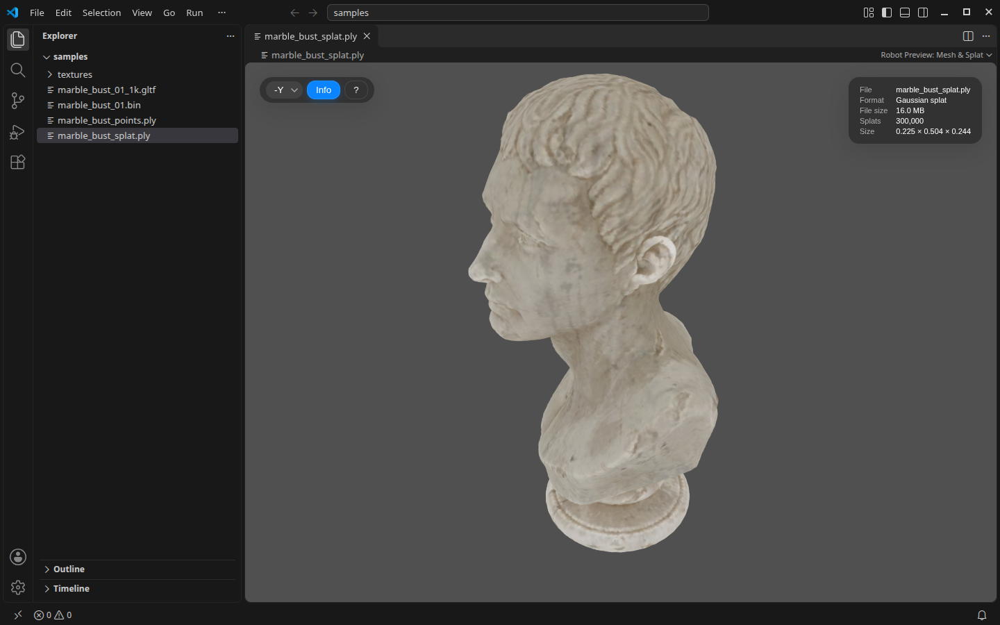

# Robot Preview: Gaussian Splat, Point Cloud, STEP & STL Viewer

Open Gaussian splats, point clouds, STEP and IGES CAD models and meshes in VS Code as a 3D view, including the large files other viewers give up on.

## Highlights

- **Large point clouds**: a 1.2 GB, 39M-point PCD opens in about 5 s and orbits at 21 fps. Past 10M points, *Load detail in view* (Display menu) reads more points where the camera looks.
- **Fast STEP**: a 39 MB assembly opens in about 3 s and a 161 MB one in about 16 s; unchanged files reopen from cache in about 1 s.
- **3DGS and 2DGS**: 2D Gaussian splatting PLY renders as flat discs, and 881k splats show in about 2 s at 60 fps.
- **Large meshes**: a 181 MB, 4.5M-face binary PLY opens in about 2 s.

Times are measured in VS Code 1.144; see the [design notes](https://github.com/chenyuting3077/robot-preview/blob/HEAD/docs/mesh-splat.md).

## Formats

- Meshes: `.stl` `.ply` `.obj` (+ `.mtl`) `.off` `.dae` `.gltf` `.glb` (including Draco and meshopt compression) `.3mf` `.wrl` `.3ds`
- CAD: `.stp` `.step` with part and face colors, `.igs` `.iges`
- Point clouds: `.ply` `.pcd` (binary, ASCII, `binary_compressed`) `.xyz` `.pts`, and `.asc` through *Reopen Editor With…*
- Gaussian splats: 3DGS / 2DGS `.ply`, `.splat` `.ksplat` `.spz` `.sog`

## Viewing

- Solid, wireframe and point display, point size, up-axis selection, and vertex / face / splat counts.
- Color point clouds by their original color, height or intensity.
- Save the view as a PNG screenshot.
- Orbit with the mouse, double-click to set the pivot, `F` to frame, `W` `A` `S` `D` to fly and `Q` `E` to turn; `?` lists the controls.
- Works in Restricted Mode.

Part of the Robot Preview series with [Robot Preview: URDF, Xacro & MJCF](https://marketplace.visualstudio.com/items?itemName=chenyuting3077.robot-preview-urdf-mjcf) and [Robot Preview: USD](https://marketplace.visualstudio.com/items?itemName=chenyuting3077.robot-preview-usd).

Built with [three.js](https://threejs.org/) and [Spark](https://sparkjs.dev/) by World Labs, STEP with [foxtrot](https://github.com/Formlabs/foxtrot) and [OpenCascade](https://dev.opencascade.org/) ([occt-import-js](https://github.com/kovacsv/occt-import-js)); format coverage follows [MeshLab](https://www.meshlab.net/). Screenshot: a splat derived from [Marble Bust 01](https://polyhaven.com/a/marble_bust_01) by James Ray Cock, Poly Haven (CC0).
