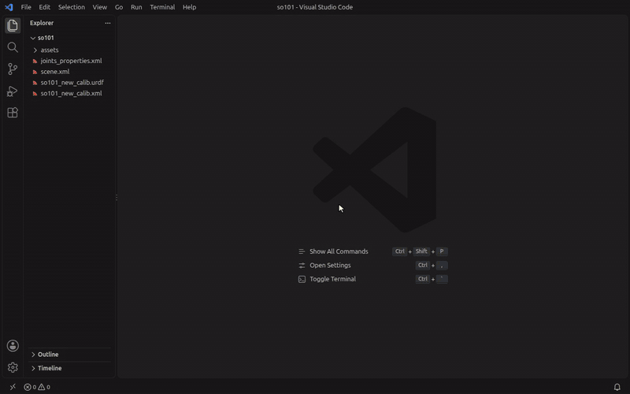
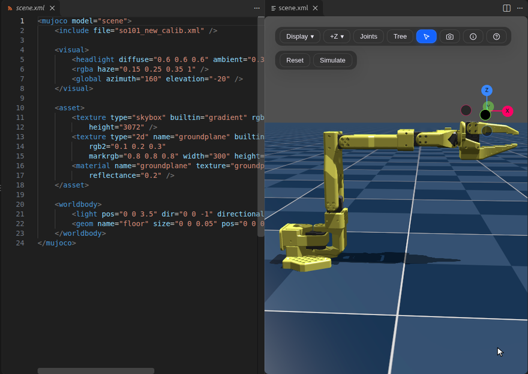

# Robot Preview: URDF, Xacro & MJCF

See your robot while you write it: a live 3D preview of URDF, Xacro, MJCF and SDF beside the text editor, with no ROS install to source.

## Open it

Open a `.urdf`, `.xacro`, MJCF `.xml`, `.sdf` or `.world` file and the preview opens beside it. If it is closed, the preview button in the editor title (or *Open Preview to the Side* in the Explorer menu) brings it back.

## Why this one

- **Meshes just load.** `package://`, `$(find)`, `model://`, absolute and `file://` paths resolve across the ROS packages of your workspace and `/opt/ros`, without a sourced shell.
- **Real Xacro.** Macros, `load_yaml`, `$(env)`, `$(optenv)`, arguments and Python such as `${r**2}`, `${int(n)}` and `${x not in l}` are expanded in the extension, also in a `.urdf` that contains xacro, and checked against ROS 2 xacro on UR, Franka, Kinova, xArm, PAL and TurtleBot3 descriptions; set arguments or export the expanded URDF from the menu.
- **Text and 3D stay together.** Click a link to jump to its source, move the cursor to highlight it, and the model updates as you type.
- **Move it.** Drag a joint in the view or use the Joints panel; MJCF models run in MuJoCo with *Simulate*.
- **Mistakes show up before RViz.** XML errors, missing meshes, broken kinematic trees, missing limits and inertia, impossible inertia and mm/m scale mistakes land in the Problems panel, with quick fixes.
- **An editor, too.** Completion, hover and Go to Definition for URDF elements and attributes, xacro macros, properties, arguments, links and include paths.

Also: visual / collision / inertia / center of mass / joint axes display, a model tree, measuring between links, mesh preview and PNG screenshots. Design notes and limits are in the [docs](https://github.com/chenyuting3077/robot-preview/blob/HEAD/docs/vscode-extension.md).

Part of the Robot Preview series with [Robot Preview: Point Cloud & Splat Viewer](https://marketplace.visualstudio.com/items?itemName=chenyuting3077.robot-preview-mesh-splat) ([Open VSX](https://open-vsx.org/extension/chenyuting3077/robot-preview-mesh-splat)) and [Robot Preview: USD Viewer (OpenUSD, Isaac Sim)](https://marketplace.visualstudio.com/items?itemName=chenyuting3077.robot-preview-usd) ([Open VSX](https://open-vsx.org/extension/chenyuting3077/robot-preview-usd)).

Based on [fan-ziqi/robot_viewer](https://github.com/fan-ziqi/robot_viewer), with [three.js](https://threejs.org/), [urdf-loader](https://github.com/gkjohnson/urdf-loaders), [xacro-parser](https://github.com/gkjohnson/xacro-parser), [mujoco_wasm](https://github.com/zalo/mujoco_wasm) and [d3](https://d3js.org/). Captures: the [SO-101 arm](https://github.com/TheRobotStudio/SO-ARM100) by TheRobotStudio (Apache-2.0).
