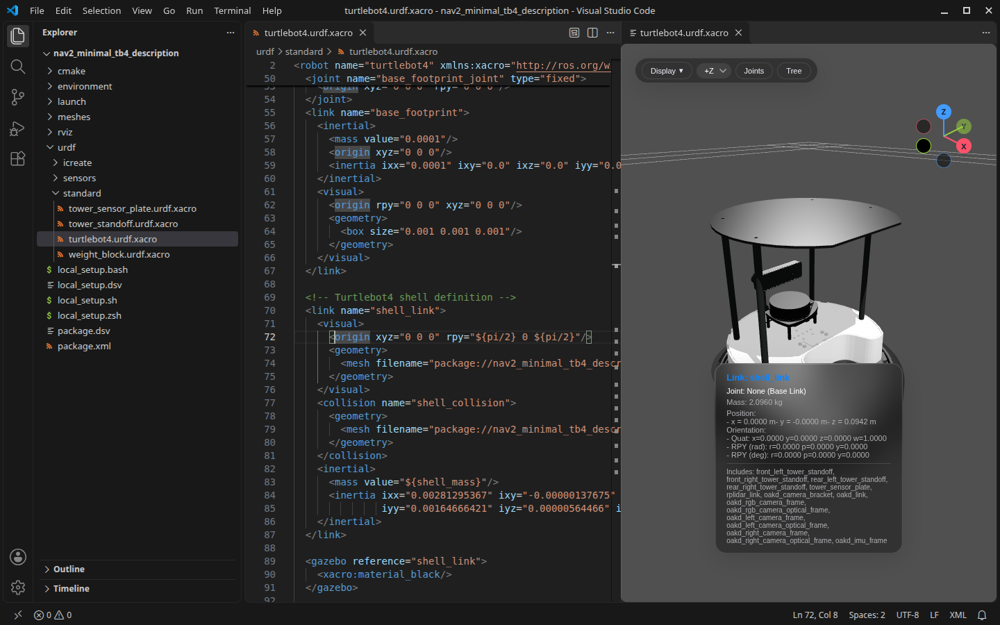

# Robot Preview: URDF, Xacro & MJCF

Live 3D preview of URDF, Xacro and MJCF beside the text editor.

- Updates as you type; click a link to jump to its source, move the cursor to highlight it.
- Resolves `package://`, `$(find)`, `model://`, absolute and `file://` paths across ROS packages; xacro `load_yaml` and `$(env)`.
- Reports XML errors, missing meshes and paths ROS would not find in the Problems panel, with quick fixes.
- Model checks: broken kinematic trees, missing limits and inertia, impossible inertia and mm/m scale mistakes.
- Go to Definition, hover and completion for xacro macros, properties, arguments, links and include paths.
- Save the view as a PNG screenshot.
- Xacro arguments, expanded URDF export, mesh preview and MuJoCo simulation.

Part of the Robot Preview series with [Robot Preview: Mesh & Splat](https://marketplace.visualstudio.com/items?itemName=chenyuting3077.robot-preview-mesh-splat) and [Robot Preview: USD](https://marketplace.visualstudio.com/items?itemName=chenyuting3077.robot-preview-usd).

Based on [fan-ziqi/robot_viewer](https://github.com/fan-ziqi/robot_viewer), with [three.js](https://threejs.org/), [urdf-loader](https://github.com/gkjohnson/urdf-loaders), [xacro-parser](https://github.com/gkjohnson/xacro-parser), [mujoco_wasm](https://github.com/zalo/mujoco_wasm) and [d3](https://d3js.org/).
