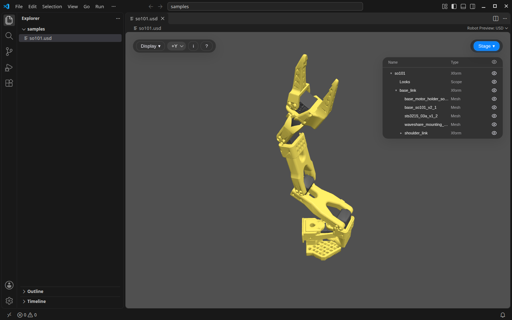

# Robot Preview: USD

Open OpenUSD robots and scenes in VS Code as a 3D view.

- `.usd` `.usdc` `.usdz`, and `.usda` through *Reopen Editor With…*
- Meshes, primitives and UsdPreviewSurface materials, following references, payloads, sublayers and variants across files (including `variantSet` blocks in `.usda` and paths into a USDZ such as `scene.usdz[0/points.usd]`), so Isaac Sim robot assets open with their links in place.
- Isaac Sim's OmniPBR (MDL) materials are shown with their colour, texture, metallic and roughness.
- The info popover shows the stage's unit and lists prim types it does not draw, such as physics joints.
- A Stage panel listing every prim with its type and an eye to show or hide it; invisible prims and collision guides start hidden.
- Gaussian splats stored as `ParticleField3DGaussianSplat` (OpenUSD 26.03) or as legacy NuRec volumes (`.nurec`), e.g. neural reconstruction scenes for Isaac Sim.
- Solid, wireframe and point display, up-axis selection, and vertex / face / splat counts.
- Orbit with the mouse, double-click to set the pivot, `F` to frame, `W` `A` `S` `D` to fly and `Q` `E` to turn; `?` lists the controls.

Part of the Robot Preview series with [Robot Preview: URDF, Xacro & MJCF](https://marketplace.visualstudio.com/items?itemName=chenyuting3077.robot-preview-urdf-mjcf) and [Robot Preview: Mesh & Splat](https://marketplace.visualstudio.com/items?itemName=chenyuting3077.robot-preview-mesh-splat).

Built with [three.js](https://threejs.org/) (its USD loader) and [Spark](https://sparkjs.dev/) by World Labs; follows the [OpenUSD](https://openusd.org/) specification. Screenshot: the [SO-101 arm](https://github.com/TheRobotStudio/SO-ARM100) by TheRobotStudio (Apache-2.0), converted from its URDF.
