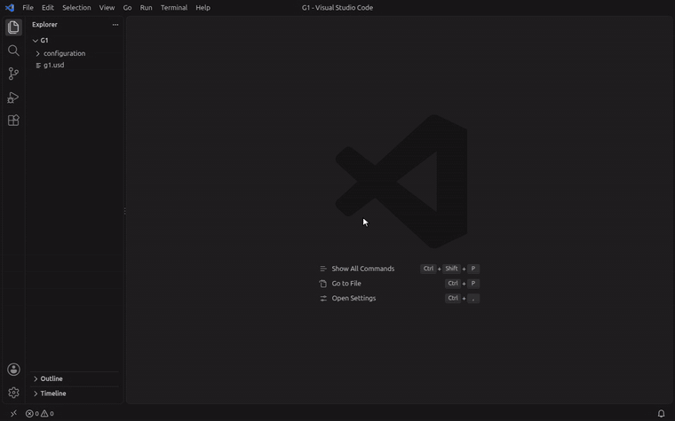
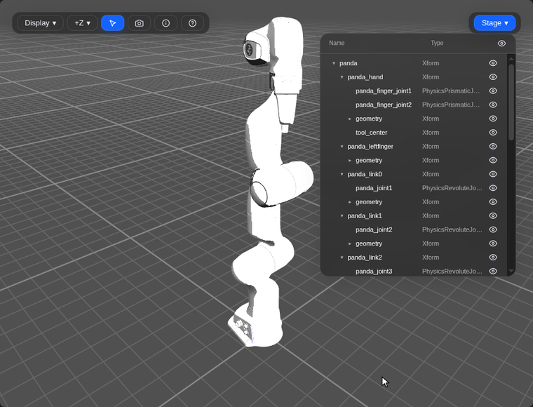

# Robot Preview: USD Viewer (OpenUSD, Isaac Sim)

Click a `.usd` in the Explorer and see the robot or scene, without starting Isaac Sim or Omniverse.

## Open it

Click a `.usd`, `.usdc` or `.usdz` file. `.usda` stays in the text editor; open its view with *Reopen Editor With…*.

## What you get

- **Isaac Sim robots open whole.** References, payloads, sublayers and variants are followed across files, so an asset split over dozens of layers shows with its links in place.
- **Isaac materials.** OmniPBR (MDL) materials show their colour, texture, metallic and roughness; UsdPreviewSurface is supported too.
- **A Stage panel.** Every prim with its type and an eye to show or hide it; click a part in the view to find its prim and path. Invisible prims and collision guides start hidden.
- **Gaussian splats in USD.** `ParticleField3DGaussianSplat` (OpenUSD 26.03) and legacy NuRec volumes (`.nurec`), such as neural reconstruction scenes for Isaac Sim.
- **What is missing, said out loud.** The info popover shows the stage's unit, materials that are bound but missing, and prim types it does not draw, such as physics joints.

Also: solid, wireframe and point display, up-axis selection, vertex / face / splat counts, PNG screenshots, and point coordinates and distances in the stage's units from the toolbar's ruler. Orbit with the mouse, double-click to set the pivot, `F` to frame, `W` `A` `S` `D` to fly and `Q` `E` to turn; `?` lists the controls. Design notes and what is not supported are in the [docs](https://github.com/chenyuting3077/robot-preview/blob/HEAD/docs/mesh-splat.md#usd).

Part of the Robot Preview series with [Robot Preview: URDF, Xacro & MJCF](https://marketplace.visualstudio.com/items?itemName=chenyuting3077.robot-preview-urdf-mjcf) ([Open VSX](https://open-vsx.org/extension/chenyuting3077/robot-preview-urdf-mjcf)) and [Robot Preview: Point Cloud & Splat Viewer](https://marketplace.visualstudio.com/items?itemName=chenyuting3077.robot-preview-mesh-splat) ([Open VSX](https://open-vsx.org/extension/chenyuting3077/robot-preview-mesh-splat)).

Built with [three.js](https://threejs.org/) (its USD loader) and [Spark](https://sparkjs.dev/) by World Labs; follows the [OpenUSD](https://openusd.org/) specification. Captures: the Unitree G1 and Franka Panda robot assets of [NVIDIA Isaac Sim](https://developer.nvidia.com/isaac/sim), rendered here; the assets belong to NVIDIA and their makers and are not part of this extension.
