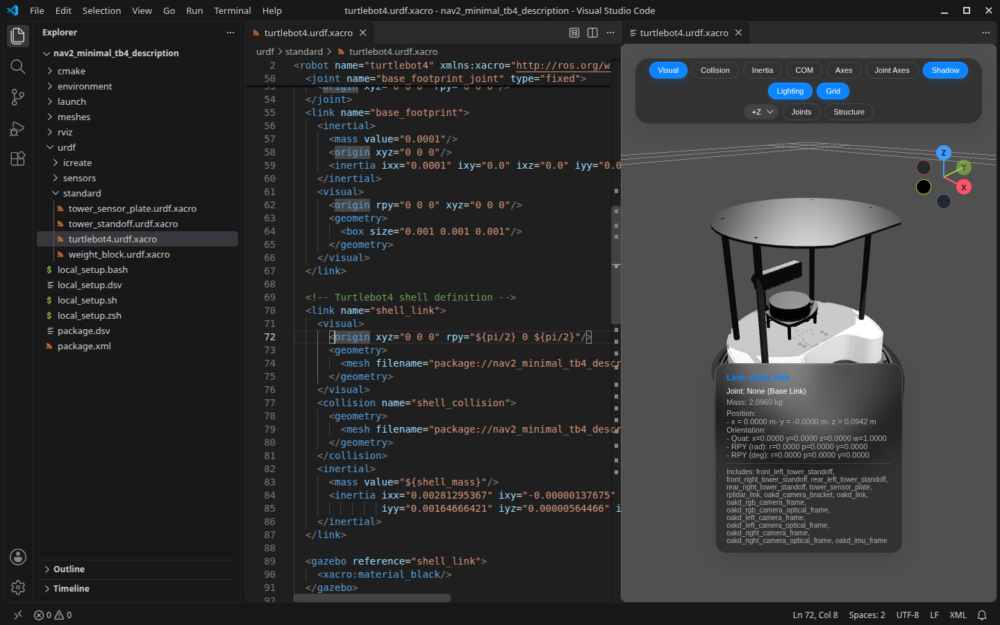
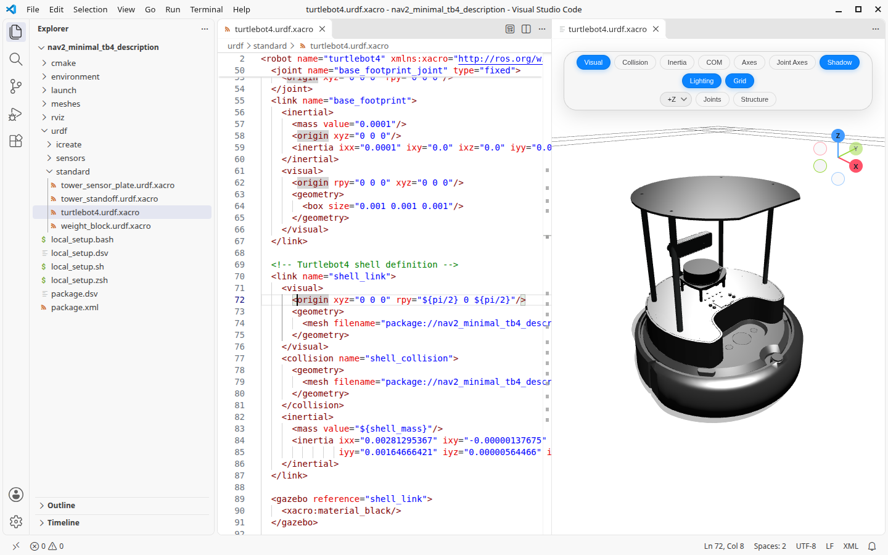

# Robot Preview: URDF & MJCF

Live 3D preview of URDF, Xacro and MJCF beside the text editor.

- Updates as you type; click a link to jump to its source, move the cursor to highlight it.
- Resolves `package://` and `$(find)` across ROS packages.
- Reports XML errors and missing meshes in the Problems panel.
- Xacro arguments, expanded URDF export, mesh preview and MuJoCo simulation.

Based on [fan-ziqi/robot_viewer](https://github.com/fan-ziqi/robot_viewer), with [three.js](https://threejs.org/), [urdf-loader](https://github.com/gkjohnson/urdf-loaders), [xacro-parser](https://github.com/gkjohnson/xacro-parser), [mujoco_wasm](https://github.com/zalo/mujoco_wasm) and [d3](https://d3js.org/).
